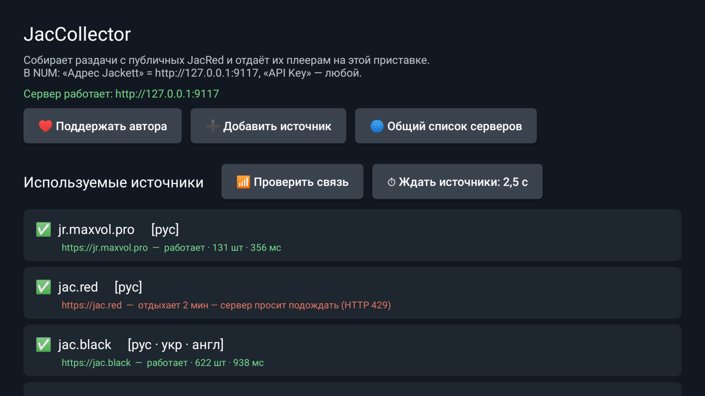

# JacCollector

Маленькое приложение для Android TV / Android, которое собирает раздачи сразу с нескольких
публичных серверов JacRed и отдаёт их плеерам (NUM, TorrStream, Lampa и другим) **как обычный
Jackett**. Отдельный сервер, ПК или Docker не нужны — всё работает прямо на приставке рядом с
TorrServer.



## Зачем

- **Быстро.** Свой Jackett ищет на трекерах «вживую» на каждый запрос (5–60 с). JacRed отдаёт
  результаты из заранее собранной базы, а JacCollector опрашивает несколько таких серверов
  **одновременно** и отвечает за 1–2 секунды.
- **Надёжно.** Если один сервер упал или заблокирован, результаты приходят с остальных. Сервер,
  который трижды подряд не ответил, пропускается 15 минут, потом проверяется снова. Новые
  рабочие серверы приходят сами через общий список.
- **Больше результатов.** Ответы склеиваются, одинаковые раздачи (по info-hash) убираются.
  У всех результатов есть magnet-ссылка.

## Установка и настройка

1. Скачайте APK из [Releases](../../releases) и установите на приставку.
2. Откройте **JacCollector** один раз — он запустится и дальше будет стартовать сам при
   включении приставки.
3. В плеере в настройках Jackett укажите:
   - **Адрес Jackett:** `http://127.0.0.1:9117`
   - **API Key:** любой (не проверяется)

В NUM это «Настройки торрент-трекеров» → Jackett.

Другие устройства в домашней сети тоже могут им пользоваться: адрес вида
`http://<IP приставки>:9117` показан на экране приложения.

## Экран приложения

- **♥ Поддержать автора · ➕ Добавить источник · 🌐 Общий список серверов**;
- **Используемые источники** — карточки серверов: статус (работает / ошибка / отдыхает), языки
  раздач (`рус · укр · англ`, определяются автоматически), 🔑 — сервер с ключом, 🏠 — домашний.
  OK на карточке — выключить или удалить именно этот сервер;
- **📶 Проверить связь** — проверка ваших серверов; **⏱ Ждать источники** — сколько ждать
  медленные серверы (по умолчанию 2,5 с; опоздавший ответ попадёт в выдачу при повторном поиске);
- «Последние запросы» внизу — что спрашивал плеер, сколько нашлось и за сколько.

Добавленный сервер проверяется сразу. Чтобы не попасть в бан на публичных серверах, приложение
шлёт каждому не больше 12 запросов в минуту, а на ответ «подождите» (HTTP 429) делает паузу
10 мин → 30 мин → 2 ч → 6 ч.

## Общий список серверов

Переключатель **«🌐 Пользоваться общим списком серверов»** (в настройках, включён по умолчанию)
работает по принципу «либо-либо»:

- **Включён.** Приставка раз в сутки (и при открытии общего списка) получает список серверов:
  рекомендованные добавляются сами, остальные можно выбрать вручную; серверы, которые перестали
  работать у других, выключаются, а когда оживут — включаются обратно. Удалённое вами не
  возвращается. Взамен в общую базу уходит:
  - адрес публичного сервера, который вы добавили, — только если он реально отвечает на поиск
    и не индексирует 18+ трекеры; вместе с ним — сколько на нём русских раздач и язык системы;
  - отметка «сервер из общего списка перестал / начал отвечать» (не чаще раза в сутки).
- **Выключен.** Ничего не отправляется и не скачивается, а пользоваться можно только личными
  серверами — домашними адресами или серверами с API-ключом.

**Не отправляется никогда:** поисковые запросы, домашние адреса, API-ключи, идентификаторы
устройства.

Список хранится в [`sources.json`](sources.json), база — в Firebase (правила — в
[`firebase/`](firebase/)).

## Что поддерживается (API)

- Jackett JSON: `/api/v2.0/indexers/{любой}/results?Query=...` (формат jac.red)
- Torznab: `/api/v2.0/indexers/{любой}/results/torznab/api?t=search&q=...`
- `/api/v2.0/indexers`, `/api/v2.0/server/config`

Требования: Android 5.0+. Проверено на NVIDIA SHIELD (Android 11) с NUM.

## Сборка

JDK 17–21, Gradle 8.x, Android SDK (platform 35). Библиотек, кроме стандартной Kotlin, нет.

```
build.cmd            # debug APK
build.cmd release    # release APK (подписывается, если есть keystore.properties)
```

Пути к JDK/Gradle — в `local-env.cmd`, к SDK — в `local.properties` (оба не в git).

## Поддержать автора

[Boosty](https://boosty.to/steklorez) · [Ko-fi](https://ko-fi.com/I3I0273OYI) — в приложении есть кнопка
«♥ Поддержать автора» с QR-кодами для телефона.

## Отказ от ответственности

Приложение только пересылает поисковые запросы к публичным серверам и не хранит и не раздаёт
контент. Ответственность за использование результатов лежит на пользователе.

---

**English.** JacCollector is a tiny Android TV app that exposes a Jackett-compatible API on
`127.0.0.1:9117`, queries several public JacRed mirrors in parallel, merges and de-duplicates the
results by info-hash and returns them within a deadline. Point your player's Jackett address to
`http://127.0.0.1:9117` (any API key). An optional shared server list (on by default) brings new
mirrors and, in return, sends the public server addresses you add and dead-server reports; search
queries, home addresses and keys are never sent. MIT license.
