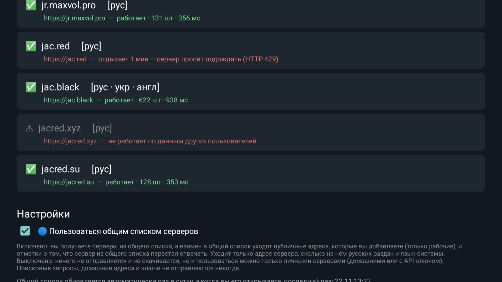
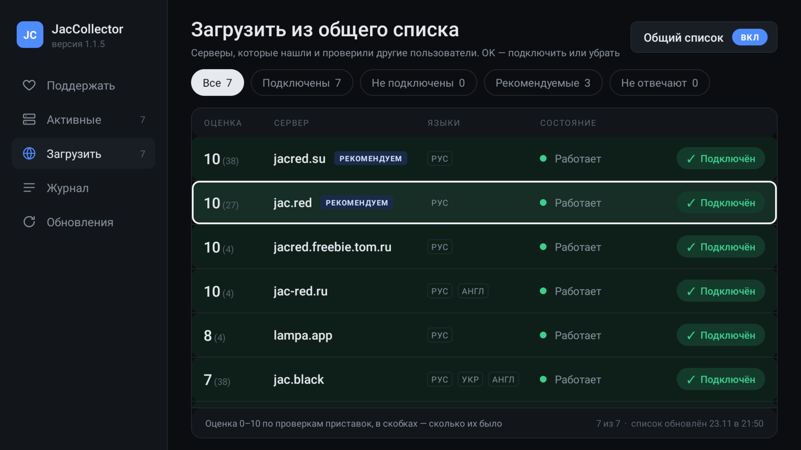
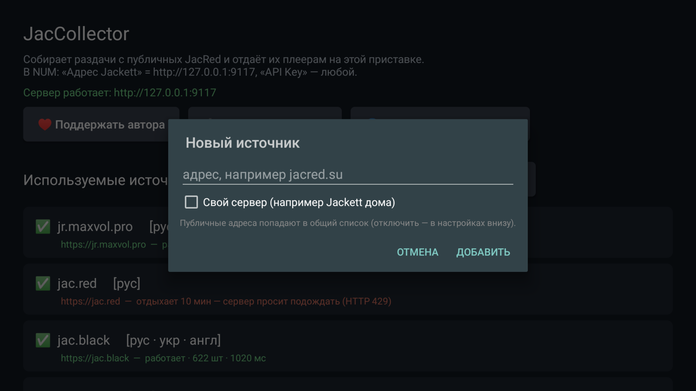

# JacCollector

[](https://github.com/Steklorez/JacCollector/releases/latest)
[](https://github.com/Steklorez/JacCollector/releases)

Маленькое приложение для Android TV / Android, которое собирает раздачи сразу с нескольких
публичных серверов JacRed и отдаёт их плеерам (NUM, TorrStream, Lampa и другим) **как обычный
Jackett**. Отдельный сервер, ПК или Docker не нужны — всё работает прямо на приставке рядом с
TorrServer.

<div align="center">


### ☕ Нравится JacCollector? Поддержите автора — угостите кофе!

[](https://ko-fi.com/I3I0273OYI)
[](https://boosty.to/steklorez)

<a href="https://ko-fi.com/I3I0273OYI"></a>&nbsp;&nbsp;&nbsp;&nbsp;<a href="https://boosty.to/steklorez"></a>


</div>


| Серверы и настройки | Общий список серверов | Добавление источника |
|---|---|---|
|  |  |  |

## Зачем

- **Быстро.** Свой Jackett ищет на трекерах «вживую» на каждый запрос (5–60 с). JacRed отдаёт
  результаты из заранее собранной базы, а JacCollector опрашивает несколько таких серверов
  **одновременно** и отвечает за 1–2 секунды.
- **Надёжно.** Если один сервер упал или заблокирован, результаты приходят с остальных. Сервер,
  который трижды подряд не ответил, пропускается 15 минут, потом проверяется снова. Новые
  рабочие серверы приходят сами через общий список.
- **Больше результатов.** Ответы склеиваются, одинаковые раздачи (по info-hash) убираются.
  У всех результатов есть magnet-ссылка.

## Установка и настройка

1. Скачайте APK из [Releases](../../releases) и установите на приставку.
2. Откройте **JacCollector** один раз — он запустится и дальше будет стартовать сам при
   включении приставки.
3. Включите галочку **«🌐 Пользоваться общим списком серверов»** — без неё приложение
   работает только с вашими личными серверами (домашними или с API-ключом).
4. В плеере в настройках Jackett укажите:
   - **Адрес Jackett:** `http://127.0.0.1:9117`
   - **API Key:** любой (не проверяется)

В NUM это «Настройки торрент-трекеров» → Jackett.

Другие устройства в домашней сети тоже могут им пользоваться: адрес вида
`http://<IP приставки>:9117` показан на экране приложения.

## Экран приложения

- **♥ Поддержать автора · ➕ Добавить источник · 🌐 Общий список серверов**;
- **Используемые источники** — карточки серверов: статус (работает / ошибка / отдыхает), языки
  раздач (`рус · укр · англ`, определяются автоматически), 🔑 — сервер с ключом, 🏠 — домашний.
  OK на карточке — выключить или удалить именно этот сервер;
- **📶 Проверить связь** — проверка ваших серверов; **⏱ Ждать источники** — сколько ждать
  медленные серверы (по умолчанию 2,5 с; опоздавший ответ попадёт в выдачу при повторном поиске);
- «Последние запросы» внизу — что спрашивал плеер, сколько нашлось и за сколько.

Сертификаты: на Android 5–7.0 приложение само доверяет корню Let's Encrypt (ISRG Root X1), а если
сервер забыл отдать промежуточный сертификат, приложение докачивает его по адресу из сертификата
сервера (как это делают браузеры). Вся цепочка всё равно проверяется до доверенного корня.

Добавленный сервер проверяется сразу. Чтобы не попасть в бан на публичных серверах, приложение
шлёт каждому не больше 12 запросов в минуту, а на ответ «подождите» (HTTP 429) делает паузу
1 мин → 10 мин → 30 мин → 2 ч → 6 ч. Серверу, который так ответил, включается **бережный
режим**: запросы к нему идут по одному с промежутком (2 с, при повторных 429 — до 15 с), лишние
из пачки поисков отбрасываются; после долгой нормальной работы режим сам ослабевает.

## Общий список серверов

Переключатель **«🌐 Пользоваться общим списком серверов»** (в настройках; в новой установке выключен — включите его сами)
работает по принципу «либо-либо»:

- **Включён.** Приставка раз в сутки (и при открытии общего списка) получает список серверов:
  рекомендованные добавляются сами, остальные можно выбрать вручную; серверы, которые перестали
  работать у других, выключаются, а когда оживут — включаются обратно. Удалённое вами не
  возвращается. Взамен в общую базу уходит:
  - адрес публичного сервера, который вы добавили, — только если он реально отвечает на поиск
    и не индексирует 18+ трекеры; вместе с ним — сколько на нём русскоязычных раздач и язык системы;
  - отметка «сервер из общего списка работает / не работает у меня» (не чаще раза в 12 часов
    на сервер).

  Вместе с этим уходит анонимный номер установки: приложение без регистрации получает его от
  Firebase (анонимный вход — без email, аккаунта Google и данных устройства; после переустановки
  будет новый). Он нужен, чтобы каждую приставку учитывать один раз: одна установка = одна
  запись на сервер, обновить её можно не чаще раза в 12 часов. Номер подписан Google, поэтому
  подделать его или писать в чужие записи нельзя.
- **Выключен.** Ничего не отправляется и не скачивается, а пользоваться можно только личными
  серверами — домашними адресами или серверами с API-ключом.

**Оценка серверов.** Раз в сутки GitHub Action ([`rating.yml`](.github/workflows/rating.yml))
сводит отметки за 7 дней в [`ratings.json`](https://github.com/Steklorez/JacCollector/blob/stats/ratings.json)
(ветка `stats`): оценка 0–10 — у какой доли приставок сервер работал, в скобках — сколько
приставок отметилось. В приложении она показана цветной полоской у каждого сервера (зелёная /
оранжевая / красная), общий список отсортирован по ней. Оценка появляется, когда отметились
хотя бы 3 приставки.

**Не отправляется никогда:** поисковые запросы, домашние адреса, API-ключи, идентификаторы
устройства.

Список хранится в [`sources.json`](sources.json), база — в Firebase (правила — в
[`firebase/`](firebase/)).

## Что поддерживается (API)

- Jackett JSON: `/api/v2.0/indexers/{любой}/results?Query=...` (формат jac.red)
- Torznab: `/api/v2.0/indexers/{любой}/results/torznab/api?t=search&q=...`
- `/api/v2.0/indexers`, `/api/v2.0/server/config`

Требования: Android 5.0+. Проверено на NVIDIA SHIELD (Android 11) с NUM.

## Сборка

JDK 17–21, Gradle 8.x, Android SDK (platform 35). Библиотек, кроме стандартной Kotlin, нет.

```
build.cmd            # debug APK
build.cmd release    # release APK (подписывается, если есть keystore.properties)
```

Пути к JDK/Gradle — в `local-env.cmd`, к SDK — в `local.properties` (оба не в git).

## Лицензия

[GNU GPL v3](LICENSE): код можно свободно использовать и изменять, но любые распространяемые
версии, основанные на нём, тоже должны быть открыты под GPLv3.

## Отказ от ответственности

Приложение только пересылает поисковые запросы к публичным серверам и не хранит и не раздаёт
контент. Ответственность за использование результатов лежит на пользователе.

---

**English.** JacCollector is a tiny Android TV app that exposes a Jackett-compatible API on
`127.0.0.1:9117`, queries several public JacRed mirrors in parallel, merges and de-duplicates the
results by info-hash and returns them within a deadline. Point your player's Jackett address to
`http://127.0.0.1:9117` (any API key). An optional shared server list (on by default) brings new
mirrors and, in return, sends the public server addresses you add and dead-server reports; search
queries, home addresses and keys are never sent. Licensed under GPL-3.0.
